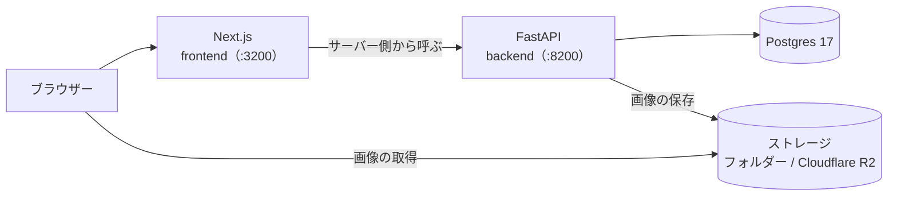

# JobNavi（星庭ジョブ）

[](https://github.com/Starlight-Tree/JobNavi/actions/workflows/ci.yml)

[English](README.md) | 日本語

月面・軌道都市・惑星ザーハードの植物園とガーデンの求人を探せる、架空の求人サイト「JobNavi」です（FastAPI、Next.js、Postgres 17、Docker Compose）。運営の「星庭ワークス」、地名、通貨「ルミ」、データはすべて架空です。

| 求人検索（条件ごとの件数つき） | 求人の詳細（画像つき） |
|---|---|
| <a href="docs/images/search.png"><picture><source media="(prefers-color-scheme: dark)" srcset="docs/images/search-dark.png"></picture></a> | <a href="docs/images/detail.png"><picture><source media="(prefers-color-scheme: dark)" srcset="docs/images/detail-dark.png"></picture></a> |

## 特徴

- **求人検索。** 条件（雇用形態・エリア・乗り場・職種）は URL に持ちます。同じ種類の中は OR、種類の間は AND で、条件ごとの件数を出し、選んだ条件はチップで外せます。
- **求職者向けの 3 問の診断。** `/diagnosis` はログイン不要です（サイドバーと検索画面からリンクします）。雇用形態・エリア（どちらも「こだわらない」を選べます）・職種（カテゴリーごとにまとめた選択欄）を尋ねます。答えは URL に入ります（単純な GET フォームなので、JavaScript なしでも動き、結果を共有できます）。結果は、選んだ条件の 1 つ以上に合う求人を最大 6 件、合う数が多い順（同数は求人 ID 順）に並べ、それぞれにどの条件が合ったかの 1 行と、同じ条件で求人検索を開くリンクを付けます。数えるだけで、AI も学習も使わず、API が返す先頭 50 件の求人が対象です。
- **求職者と園の別々のログイン。** アカウントも Cookie も別です。求職者は Google でのログインだけ（DocuNavi と同じ Better Auth を、画面のサーバー（Next.js）の中で動かします。はじめてのログインで登録されます）。園はパスワード（argon2）。セッションは HttpOnly の Cookie。権限は API が毎回 SQL の条件で確かめ、他の園の求人は 404 です。
- **園による画像の管理。** 求人の画像をドラッグ＆ドロップで追加（保存前にプレビュー）・並べ替え・ヒーロー指定・削除できます。検証（形式・容量・寸法）と、位置情報を除く再エンコードは API が行います（[docs/image-storage.md](docs/image-storage.md)）。
- **画像の置き場を差し替えられる。** 本体はストレージ（開発はフォルダー、本番は S3 互換の Cloudflare R2 を想定）、求人との対応は DB に置き、途中で失敗しても食い違いを `reconcile` で報告できます。
- **番号付き SQL のマイグレーション。** 適用済みのファイルは sha256 で改ざんを検出し、初期スキーマは指紋と照合します。

## アーキテクチャ



ブラウザーは API を直接呼ばず、画面のサーバー側（サーバーアクション、Server Component）が API を呼びます。そのとき、ログイン中の求職者の短命の JWT（Better Auth が出す。ES256）を付け、API は、画面が配る JWKS の公開鍵で検証します。セッションは HttpOnly の Cookie です。画面のコンテナは、API と同じ DB の資格情報を持ちます（表ごとの権限分けは、まだしていません）。ただ、コードが使うのはログインの表（`auth_`）だけで、アプリのデータは、これまでどおり API 経由です。画像は、公開 URL からブラウザーが取得します。

## クイックスタート

Docker Compose で、DB・API・画面を動かします。初めての環境（空の DB）では、`migrate`、`seed`、`seed-images` を 1 回ずつ実行します（`up` では起動しない道具です）。`seed` と `seed-images` はダミーデータの投入で、`DEMO_DATA=allow` が無いと実行を拒否します（Compose の定義が渡します）。

```bash
docker compose up -d db
docker compose run --rm migrate       # マイグレーション
docker compose run --rm seed          # ダミーの求人とアカウント
docker compose run --rm seed-images   # ダミーの画像
docker compose up -d --build
```

- 画面: <http://localhost:3200>、API の文書: <http://localhost:8200/docs>
- 止める: `docker compose down`。DB ごと消すなら `docker compose down -v`
- ダミーのアカウント（ローカル専用）: 園 `hoshiniwa-garden@example.com`、パスワード `star-garden-demo`、`/garden/login` から入ります。ダミーの求職者 `hoshiniwa-user@example.com` にもパスワードはありますが、画面は Google でのログインだけです。確認済みの同じメールアドレスの Google アカウントで、はじめてログインしたとき、このアカウントに結ばれます。
- Google でのログインには、Google Cloud Console で作る OAuth クライアント（種類: ウェブ。コマンドや API はありません）が要ります。リダイレクト URI は `http://localhost:3200/api/auth/callback/google` です。そのあと、`scripts/login-secrets.sh <Infisical のプロジェクト ID>` で 3 つの値を登録します（クライアント ID とシークレットは、画面に出さずに入力します。`BETTER_AUTH_SECRET` はその場で 1 回だけ作り、作り直しません）。起動は `infisical run --projectId <プロジェクト ID> --env dev -- docker compose up -d` です。Infisical を使わないときは、`GOOGLE_CLIENT_ID`・`GOOGLE_CLIENT_SECRET`・`BETTER_AUTH_SECRET`（32 文字以上のランダムな値。例: `openssl rand -base64 32`）を `.env`（Git に入れない）に書き、`docker compose up -d` します。画面を使う前に `migrate`（マイグレーション 0004 が `auth_` の表を足します）を 1 回流してください。先に画面を使ったときは、`frontend` コンテナを再起動します。無いときは、ログイン画面に「Google でのログインは、まだ設定されていません」と出ます。シークレットは画面のコンテナ（Better Auth）が持ち、API には渡しません。
- **`BETTER_AUTH_SECRET` は、決めたら変えません。** DB の `auth_jwks` の署名鍵と、`auth_account` の Google のトークンを暗号化しているためです。変えると、全員がログアウトに見え、画面のログに `Failed to decrypt private key` と出ます。直すには `auth_jwks` の行を消す必要があります（消す前に確認します）。DB のバックアップと一緒に、Infisical で持ちます。

テスト: `cd backend && pip install -r requirements.txt -r requirements-dev.in && TEST_DATABASE_URL=<Postgres の URL> pytest` と `cd frontend && npm ci && npm test && npm run build && npm run typecheck`（ホストで実行します。開発コンテナの作業ツリーで `npm ci` すると、ホストの `node_modules` を上書きすることがあります）。`TEST_DATABASE_URL` が無いと、DB を使うテストは飛ばされます。

## ドキュメント

文書は日本語です。

| 文書 | 内容 |
|---|---|
| [docs/development.md](docs/development.md) | 構成と版、テスト、ダミーデータ、マイグレーション、CI |
| [docs/image-storage.md](docs/image-storage.md) | 画像の仕組み、設定、マイグレーション、バックアップと復旧、R2 |
| [docs/ux-research.md](docs/ux-research.md) | 求人検索の画面の調査と採用した案 |
| [docs/image-gen-resources.md](docs/image-gen-resources.md) | 画像生成ジョブ（試作）の設定と確認の記録 |
| [docs/access-separation.md](docs/access-separation.md) | 権限と資格情報のプロジェクトごとの分離（開発コンテナのボリューム、MCP、Infisical、GCP） |
| [CLAUDE.md](CLAUDE.md) | 開発の規約（AI エージェント向け。各フォルダーにもあります） |

## このリポジトリについて

ポートフォリオとして公開している個人開発で、2 種類の利用者（求人を探す人と園）の認証・権限の分離、画像の安全な受け入れと保存、既存の DB を壊さないマイグレーションといった課題を試すために作りました。秘密情報は含みません（`.env` は Git の管理外で、`.env.example` だけを置いています）。パターンによる秘密の検査は、完全な保証ではありません。

## ライセンス

[MIT](LICENSE)
