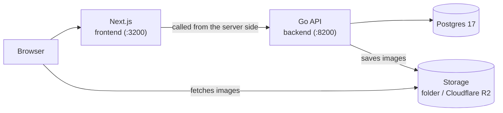

# JobNavi

[](https://github.com/Starlight-Tree/JobNavi/actions/workflows/ci.yml)

English | [日本語](README.ja.md)

JobNavi (星庭ジョブ) is a fictional job board for botanical gardens on the Moon, in orbital cities and on the planet Zahard (Go, Next.js, Postgres 17, Docker Compose). The operator "Hoshiniwa Works", the place names, the currency "lumi" and all data are made up.

| Job search (with counts per filter) | Job detail (with images) |
|---|---|
| <a href="docs/images/search.png"><picture><source media="(prefers-color-scheme: dark)" srcset="docs/images/search-dark.png"></picture></a> | <a href="docs/images/detail.png"><picture><source media="(prefers-color-scheme: dark)" srcset="docs/images/detail-dark.png"></picture></a> |

## Features

- **Job search.** Filters (employment type, area, station, occupation) live in the URL. Values of one kind are OR-ed, kinds are AND-ed; each filter shows its count, and selected filters are chips you can remove.
- **Three-question diagnosis for job seekers.** `/diagnosis` needs no sign-in (it is linked from the sidebar and from the search page). It asks for an employment type, an area (each with a "no preference" choice) and an occupation (a select grouped by category). The answers go in the URL (a plain GET form, so it works without JavaScript and a result can be shared). The result lists up to six jobs that match at least one of the chosen conditions, most matches first (ties by job ID), each with a line saying which conditions matched, and a link to the job search with the same filters. It only counts matches, with no AI or learning, over the first 50 jobs the API returns.
- **Separate logins for job seekers and gardens.** Separate accounts and cookies. Job seekers sign in with Google only, through Better Auth running inside the Next.js server (like DocuNavi; a first sign-in registers the account). Gardens use a password (argon2). Sessions are HttpOnly cookies. The API checks permissions in SQL on every request, and another garden's job is a 404.
- **Image management by gardens.** Add images by drag and drop (with a preview before saving), reorder, set the hero image, delete. The API validates format, size and dimensions and re-encodes without location data ([docs/image-storage.md](docs/image-storage.md)).
- **Swappable image storage.** The files live in storage (a folder in development, an S3-compatible Cloudflare R2 bucket for production), the links to jobs live in the DB, and `reconcile` reports any mismatch left by a failure.
- **Numbered SQL migrations.** Applied files are checked by sha256 to detect edits, and the initial schema is checked against a fingerprint.

## Architecture



The browser never calls the API directly; the server side of the UI (server actions, Server Components) does, sending the signed-in job seeker's short-lived JWT (Better Auth, ES256), which the API verifies against the JWKS served by the UI. Sessions are HttpOnly cookies. The UI container holds the same database credentials as the API (there are no per-table grants yet), but its code only uses the `auth_` tables (Better Auth); all app data still goes through the API. Images are fetched by the browser from a public URL.

## Quick start

Docker Compose runs the DB, the API and the UI. On a new environment (empty DB), run `migrate`, `seed` and `seed-images` once each (they are tools that `up` does not start). `seed` and `seed-images` load dummy data and refuse to run without `DEMO_DATA=allow` (the Compose file passes it).

```bash
docker compose up -d db
docker compose run --rm migrate       # migrations
docker compose run --rm seed          # dummy jobs and accounts
docker compose run --rm seed-images   # dummy images
docker compose up -d --build
```

- UI: <http://localhost:3200>, API health check: <http://localhost:8200/health> (the routes are listed in [docs/development.md](docs/development.md); the FastAPI `/docs` page went away with the Go rewrite, see [docs/go-migration.md](docs/go-migration.md))
- Stop: `docker compose down`. To delete the DB as well: `docker compose down -v`
- Dummy accounts (local only): garden `hoshiniwa-garden@example.com`, password `star-garden-demo`, signing in at `/garden/login`. The dummy job seeker `hoshiniwa-user@example.com` has a password too, but the UI offers Google sign-in only. A Google account with the same verified email is linked to it on the first sign-in.
- Google sign-in needs an OAuth client (type: Web) that you create in Google Cloud Console (it has no CLI or API), with the redirect URI `http://localhost:3200/api/auth/callback/google`. Then register the three values with `scripts/login-secrets.sh <Infisical project ID>` (it prompts for the client ID and secret without echoing them, generates `BETTER_AUTH_SECRET` once, and never overwrites it) and start with `infisical run --projectId <ID> --env dev -- docker compose up -d`. Without Infisical, put `GOOGLE_CLIENT_ID`, `GOOGLE_CLIENT_SECRET` and `BETTER_AUTH_SECRET` (32+ random characters, e.g. `openssl rand -base64 32`) in `.env` (not in Git) and run `docker compose up -d`. Run the `migrate` tool once before using the UI (migration 0004 adds the `auth_` tables); if the UI was used before that, restart the `frontend` container. Without the secrets the login page says Google sign-in is not configured. The secrets go to the UI container (Better Auth); the API gets none.
- **Never change `BETTER_AUTH_SECRET` once it is set.** It encrypts the JWT signing key in `auth_jwks` and the Google tokens in `auth_account`. After a change everyone looks logged out and the UI log shows `Failed to decrypt private key`; recovering needs the `auth_jwks` rows deleted (ask first). Keep the secret together with the database backup (Infisical).

Tests: `cd backend && TEST_DATABASE_URL=<Postgres URL> go test -tags nodynamic ./...` (Go 1.26 or later) and `cd frontend && npm ci && npm test && npm run build && npm run typecheck` (run on the host: `npm ci` inside the dev container's working tree would overwrite the host's `node_modules`). Without `TEST_DATABASE_URL`, the tests that need the DB are skipped.

## Documentation

The documents are written in Japanese.

| Document | Contents |
|---|---|
| [docs/development.md](docs/development.md) | Layout and versions, tests, dummy data, migrations, CI |
| [docs/image-storage.md](docs/image-storage.md) | How images work, settings, migrations, backup and restore, R2 |
| [docs/ux-research.md](docs/ux-research.md) | Research on the job search screen and the design chosen |
| [docs/image-gen-resources.md](docs/image-gen-resources.md) | Settings and verification record of the image generation job (prototype) |
| [docs/access-separation.md](docs/access-separation.md) | Per-project separation of credentials and permissions (dev container volumes, MCP, Infisical, GCP) |
| [CLAUDE.md](CLAUDE.md) | Development conventions (for AI agents; each folder has one too) |

## About this repository

A personal project published as a portfolio, built to explore: authentication and permission separation between two kinds of users (job seekers and gardens), safe acceptance and storage of uploaded images, and migrations that do not damage an existing DB. It contains no secrets (`.env` is outside Git; only `.env.example` is committed). Pattern-based secret checks are not a complete guarantee.

## License

[MIT](LICENSE)
